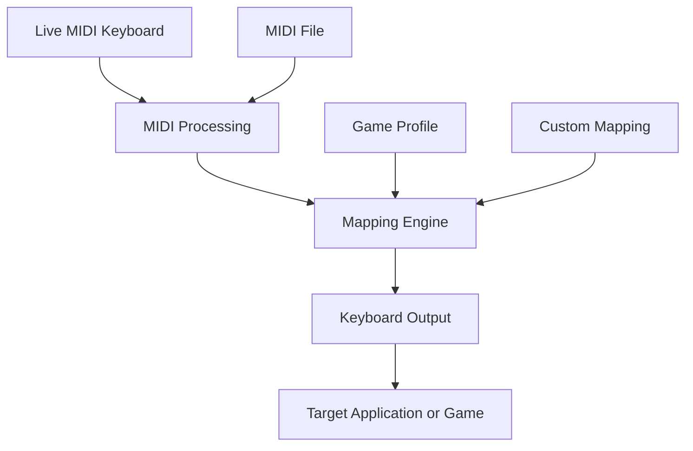

# MidiPiano

**MIDI-to-Keyboard Mapper & Player**

MidiPiano is a desktop application designed to convert MIDI input into computer keyboard inputs. It supports both real-time piano performance through a MIDI device and automatic playback from MIDI files.

The project aims to make MIDI keyboards usable with applications and games that rely on keyboard input, with customizable key mappings and dedicated game profiles.

## Overview

MidiPiano provides two main operating modes:

### 1. Live MIDI Input

Connect a physical MIDI keyboard or digital piano and play directly.

MidiPiano receives MIDI note events and translates them into corresponding keyboard inputs based on the selected mapping profile.

Use cases include:

- **Genshin Impact** – Play the Windsong Lyre using a physical MIDI keyboard.
- **Roblox** – Play in-game pianos using a MIDI keyboard.
- **Custom Applications** – Configure your own MIDI-to-keyboard mappings for other applications.

### 2. MIDI File Auto Play

Load a `.mid` file and let MidiPiano play it automatically through simulated keyboard inputs.

Instead of manually playing every note, MidiPiano processes MIDI events and translates them into keyboard inputs according to the selected mapping profile.

The intended playback system includes:

- MIDI file loading.
- Automatic note playback.
- Note timing and duration handling.
- Playback controls.
- Customizable MIDI-to-keyboard mapping.

## Key Features

### Custom Key Mapping

Configure which keyboard key corresponds to each MIDI note.

MidiPiano provides a visual piano interface where users can inspect and customize note mappings.

### Game Profiles

Dedicated mapping configurations for different applications.

| Profile | Description |
|---|---|
| Genshin Impact | Mapping designed for the Windsong Lyre. |
| Roblox | Mapping for Roblox piano experiences. |
| Custom | User-defined MIDI-to-keyboard mapping. |

Each profile is intended to be reusable across both Live MIDI Input and MIDI File Auto Play.

### Virtual Piano Interface

A visual piano keyboard for viewing MIDI notes and their assigned keyboard keys.

The interface includes:

- 49, 61, and 88-key display layouts.
- Octave navigation.
- Visual note mapping.
- Keyboard input visualization.
- Individual note mapping configuration.

## How It Works

Both operating modes are designed to use the same mapping system.



This shared architecture allows users to configure a mapping once and use it with either live performances or automatic MIDI playback.

## Current Development Status

MidiPiano is currently in early development.

### Implemented

- [x] Desktop application interface.
- [x] Virtual piano keyboard.
- [x] 49, 61, and 88-key display options.
- [x] Octave navigation.
- [x] Basic MIDI note-to-key mapping configuration.
- [x] Visual keyboard mapping representation.
- [x] Virtual piano interaction for testing the mapping interface.

### Planned

- [ ] Physical MIDI device detection and selection.
- [ ] Real-time MIDI input processing.
- [ ] Actual keyboard input simulation.
- [ ] MIDI file loading and parsing.
- [ ] Automatic MIDI file playback.
- [ ] Playback controls (Play, Pause, Stop).
- [ ] Genshin Impact mapping profile.
- [ ] Roblox mapping profile.
- [ ] Custom mapping profiles and configuration saving.
- [ ] Latency and timing configuration.
- [ ] Improved MIDI track selection and playback management.

**Note:** The current repository contains an initial GUI prototype. The implemented mapping interface is not yet connected to a complete MIDI input or operating-system keyboard output pipeline. The planned features are not yet available as working functionality.

## Technology Stack

- **C++17** – Primary programming language.
- **JUCE 7.0.9** – Desktop application framework and audio/MIDI-related foundation.
- **CMake 3.22+** – Build system.

## Building from Source

### Requirements

- C++17-compatible compiler.
- CMake 3.22 or newer.
- Git.
- Internet connection for the initial JUCE dependency download.

### Clone the Repository

```bash
git clone https://github.com/DrayeCare/MidiPiano.git
cd MidiPiano
```

### Configure the Project

```bash
cmake -S . -B build
```

### Build

```bash
cmake --build build --config Release
```

CMake automatically downloads the JUCE 7.0.9 dependency through `FetchContent`.

The compiled application will be available in the generated build artifacts directory.

## Project Goals

MidiPiano aims to provide a flexible bridge between MIDI instruments and keyboard-based applications.

Rather than limiting MIDI keyboards to traditional music software, the project explores how MIDI input and MIDI files can be used with applications that accept keyboard input.

The long-term goal is to provide a unified tool for live MIDI performance, automatic MIDI playback, and customizable keyboard mapping.

## License

License not specified yet.