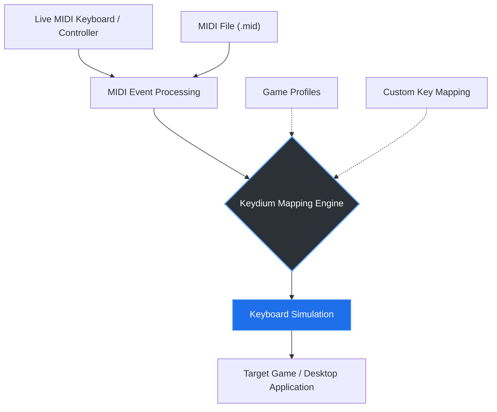

 

# 🎹 Keydium

**Your MIDI. Your Keys.**

*MIDI-to-keyboard software for games and desktop applications.*

---

## What is Keydium?

**Keydium** is a C++ desktop application designed to convert MIDI input from digital pianos and MIDI controllers into PC keyboard inputs.

It aims to bridge the gap between musical hardware and keyboard-based games or desktop applications. With MIDI-to-keyboard mapping, users will be able to play virtual piano games using a physical MIDI keyboard instead of manually pressing keys on a computer keyboard.

Keydium is being developed with use cases such as:

- **Roblox Virtual Piano** — Play in-game virtual piano experiences using a physical piano or MIDI controller.
- **Genshin Impact** — Use a digital piano to play the Windsong Lyre.
- **Rhythm Games** — Map MIDI notes to keyboard controls.
- **Desktop Applications** — Convert MIDI notes into keyboard shortcuts and inputs.

> [!NOTE]
> **Early Development:** Keydium is currently an early-stage GUI prototype. The virtual piano and key-mapping interfaces are available for visual inspection. Physical MIDI input and operating-system-level keyboard output are still under development. MIDI file playback is planned and is not yet available.

---

## Operating Modes

Keydium is designed around two main operating modes.

### 1. Live MIDI Input

Connect a physical MIDI keyboard, digital piano, or MIDI controller to send note events to Keydium.

The intended workflow is to translate incoming MIDI Note On and Note Off events into corresponding PC keyboard inputs using a selected mapping profile.

Potential use cases include:

- Playing Roblox virtual piano games with a physical piano.
- Performing Genshin Impact's Windsong Lyre using MIDI hardware.
- Controlling keyboard-driven applications through custom MIDI mappings.

<badge>In Development</badge>

### 2. MIDI File Playback

Load standard `.mid` files and automatically translate their musical events into keyboard inputs.

Planned capabilities include:

- **MIDI File Parsing:** Load and inspect standard MIDI files, including multi-track files.
- **Tempo and Timing:** Interpret note durations, tempo changes, and playback timing.
- **Playback Controls:** Control MIDI playback through the application.
- **Shared Mapping Profiles:** Use the same MIDI-to-keyboard mappings as live input.

<badge>Planned</badge>

---

## Key Features

### Current GUI Prototype

- **Virtual Piano Interface:** Visual keyboard layouts supporting 49, 61, and 88 keys.
- **Octave Shifting:** Navigate different piano ranges through octave controls.
- **Custom Key Mapping Interface:** Configure MIDI note assignments to computer keyboard keys through a per-note mapping interface.
- **Game Profile Interface:** Organize different keyboard mappings for specific games and applications.

### Planned Capabilities

- **Live MIDI Input:** Receive MIDI events from connected keyboards and controllers.
- **Keyboard Simulation:** Translate MIDI events into operating-system-level keyboard inputs.
- **Game-Specific Profiles:** Provide dedicated layouts for different games.
- **MIDI File Playback:** Automatically play `.mid` files through simulated keyboard inputs.
- **Unified Mapping Engine:** Share mapping configurations between live MIDI input and MIDI file playback.

---

## Game Profiles

Keydium is designed to support different mapping profiles depending on the target application.

| Profile | Target Application | Intended Mapping |
| :--- | :--- | :--- |
| **Genshin Impact** | Windsong Lyre | A layout based on the 21-key in-game lyre scale. |
| **Roblox** | Virtual Piano Games | Expanded keyboard mappings for virtual piano experiences. |
| **Custom** | Games and Desktop Apps | User-defined MIDI-to-keyboard assignments. |

---

## Architecture & Workflow

The planned architecture uses a shared mapping engine to process MIDI events and translate them into keyboard inputs.

Both live MIDI input and MIDI file playback are intended to use the same mapping configuration.

> [!IMPORTANT]
> This diagram represents the intended application workflow. The complete MIDI processing and keyboard simulation pipeline is not yet implemented.

---

## Technology Stack

| Technology | Purpose |
| :--- | :--- |
| **C++17** | Core application development |
| **JUCE 7.0.9** | Desktop GUI and MIDI-related framework |
| **CMake 3.22+** | Build system |

---

## Development Roadmap

- [x] Initial desktop GUI prototype
- [x] Virtual piano interface
- [x] 49, 61, and 88-key layouts
- [x] Octave shifting interface
- [x] MIDI-to-keyboard mapping interface
- [ ] Physical MIDI device input
- [ ] MIDI Note On / Note Off processing
- [ ] Operating-system-level keyboard simulation
- [ ] Functional Genshin Impact profile
- [ ] Functional Roblox Virtual Piano profile
- [ ] Custom mapping configuration
- [ ] MIDI file parsing and playback
- [ ] Unified live input and MIDI playback pipeline
- [ ] Application packaging and releases

---

## Project Status

Keydium is under active development. The current focus is building the core MIDI input and keyboard output pipeline before completing the planned playback features.

The repository currently provides an initial GUI prototype rather than a fully functional MIDI-to-keyboard application.

Contributions, technical feedback, and suggestions are welcome as the project develops.

---

**Keydium — Your MIDI. Your Keys.**
